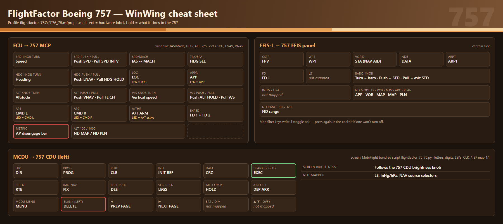
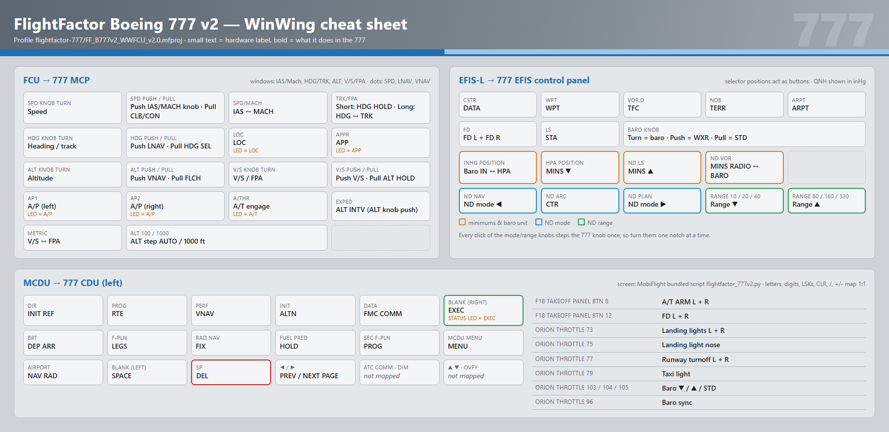
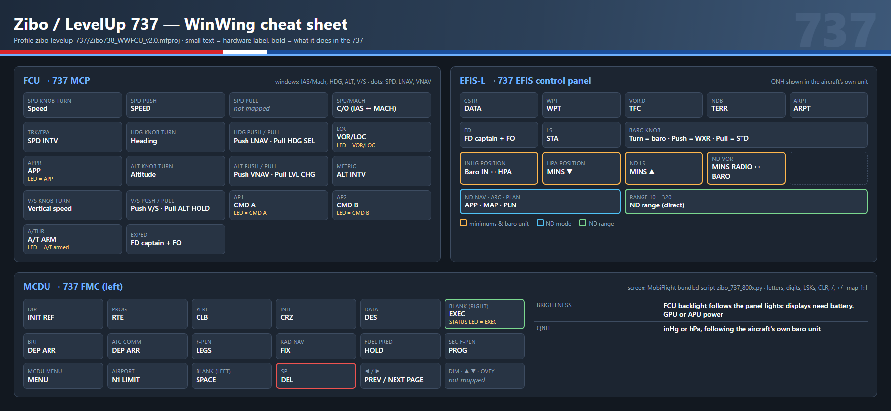
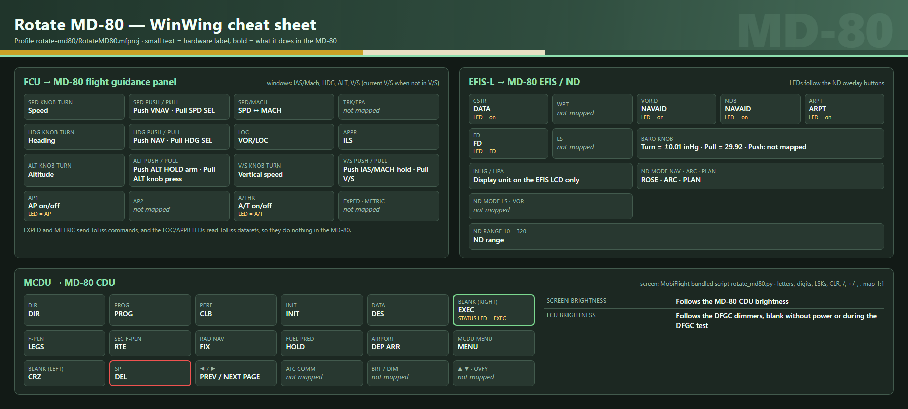
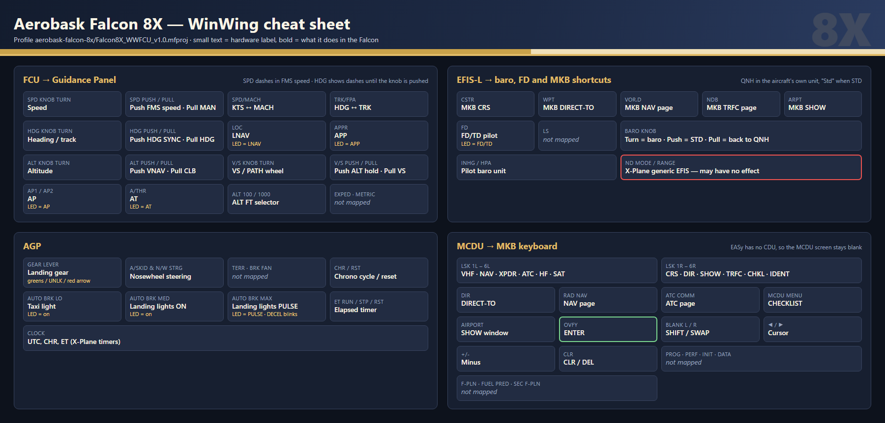
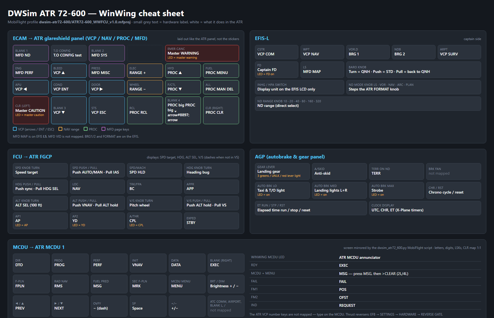

# WinWing Airbus Hardware Profiles for X-Plane (MobiFlight)

MobiFlight profiles that map **WinWing Airbus-style hardware** to non-Airbus aircraft add-ons in X-Plane 12.

## Hardware

These profiles are built for the following WinWing panels:

- **FCU-320** (Flight Control Unit)
- **EFIS-320L** (Electronic Flight Instrument System, Captain side)
- **MCDU-32 Captain** (Multi-Function Control & Display Unit)
- **AGP** (Autobrake & Gear Panel) — Falcon 8X and ATR 72-600 profiles
- **ECAM** control panel — ATR 72-600 profile

Since the hardware carries Airbus labeling (A320 FCU layout, Airbus MCDU function keys, etc.), buttons are remapped to the closest equivalent function on each aircraft. Every profile has a cheat sheet image in its folder showing what each key does.

| Profile | Folder | FCU + EFIS | MCDU | AGP | ECAM |
|---------|--------|:---:|:---:|:---:|:---:|
| FlightFactor 757 | `flightfactor-757/` | ✓ | ✓ | | |
| FlightFactor 777 v2 | `flightfactor-777/` | ✓ | ✓ | | |
| Zibo / LevelUp 737 | `zibo-levelup-737/` | ✓ | ✓ | | |
| Rotate MD-80 | `rotate-md80/` | ✓ | ✓ | | |
| Aerobask Falcon 8X | `aerobask-falcon-8x/` | ✓ | ✓ (as MKB keyboard) | ✓ | |
| DWSim ATR 72-600 | `dwsim-atr72-600/` | ✓ | ✓ | ✓ | ✓ |

## Requirements

- [MobiFlight Connector](https://www.mobiflight.com/) — **latest beta version required** for MCDU support
- X-Plane 12
- The respective aircraft add-on (see below)
- WinWing FCU-320 + EFIS-320L and/or MCDU-32 Captain hardware (plus AGP / ECAM for the profiles that use them)

## Setup

1. Download the `.mfproj` file for your aircraft
2. Open MobiFlight Connector
3. Load the profile via **File > Open**
4. **Update the Module Serial numbers** to match your hardware — the serial values in these profiles are specific to the author's devices and will not match yours. In MobiFlight, go to each input/output config item and select your actual device from the dropdown, or do a find-and-replace in the `.mfproj` JSON file.

---

## FlightFactor Boeing 757 (`flightfactor-757/`)

**Aircraft:** [FlightFactor Boeing 757](https://store.x-plane.org/Boeing-757-v2-Professional_p_222.html) (FF76_75)



### What's Mapped

**148 total config items** (30 outputs, 118 inputs) across 2 devices: FCU-320 + EFIS-320L and MCDU-32 Captain.

#### FCU → 757 MCP — 28 inputs

| FCU Control | 757 Function | Command |
|-------------|--------------|---------|
| SPD knob | Speed | `1-sim/comm/AP/spdUP` / `spdDN` |
| SPD push / pull | SPD / SPD INTV | `1-sim/command/AP/spdButton_button` / `spdConfButton_button` |
| SPD/MACH | IAS/Mach toggle | `1-sim/command/AP/iasmach_button` |
| HDG knob | Heading | `1-sim/comm/AP/hdgUP` / `hdgDN` |
| HDG push / pull | LNAV / HDG HOLD | `1-sim/comm/AP/lnavButton` / `hdgHoldButton` |
| TRK/FPA | HDG SEL | `1-sim/command/AP/hdgConfButton_button` |
| LOC / APPR | LOC / APP | `1-sim/comm/AP/locButton` / `appButton` |
| ALT knob | Altitude | `1-sim/comm/AP/altUP` / `altDN` |
| ALT push / pull | VNAV / FL CH | `1-sim/comm/AP/vnavButton` / `flchButton` |
| ALT 100 / 1000 | ND MAP / ND PLN mode | `1-sim/ndpanel/1/hsiModeRotary` = 2 / 3 |
| V/S knob | Vertical speed | `1-sim/comm/AP/vviUP` / `vviDN` |
| V/S push / pull | ALT HOLD / V/S | `1-sim/comm/AP/altHoldButton` / `vviButton` |
| AP1 / AP2 | CMD L / CMD R | `1-sim/comm/AP/CMD_L` / `CMD_R` |
| A/THR | A/T ARM toggle | `1-sim/command/AP/atSwitcher_trigger` |
| EXPED | FD 1 + FD 2 toggle | `1-sim/command/AP/fd1Switcher_trigger` + `fd2Switcher_trigger` |
| METRIC | AP disengage bar | `1-sim/command/AP/desengageLever_button` |

**Outputs:** IAS/Mach, HDG, ALT and V/S windows with SPD/V/S dashes; dots for SPD, HDG (LNAV) and ALT (VNAV); LEDs AP1 = CMD L, AP2 = CMD R, A/THR = A/T active, LOC, APPR. The LCD follows the glareshield light knob and the backlight the panel lights.

#### EFIS-320L — 21 inputs

| EFIS Control | 757 Function | Dataref/Command |
|--------------|--------------|-----------------|
| FD (33) | FD 1 toggle | `1-sim/command/AP/fd1Switcher_trigger` |
| CSTR (35) | FPV | `1-sim/ndpanel/1/fpv` = 1 |
| WPT (36) | WPT overlay | `1-sim/ndpanel/1/map5` = 1 |
| VOR.D (37) | STA / NAV AID overlay | `1-sim/ndpanel/1/map2` = 1 |
| NDB (38) | DATA overlay | `1-sim/ndpanel/1/map4` = 1 |
| ARPT (39) | ARPT overlay | `1-sim/ndpanel/1/map3` = 1 |
| BARO push / pull (40/41) | STD on / off | `1-sim/ng/baro/std/L` = 1 / 0 |
| BARO knob (42/43) | Baro setting | `1-sim/command/gauges/baroRotary_left_rotary-` / `+` |
| ND mode LS / VOR / NAV / ARC / PLAN (46–50) | APP / VOR / MAP / MAP / PLN | `1-sim/ndpanel/1/hsiModeRotary` = 1 / 0 / 2 / 2 / 3 |
| ND range 10–320 (51–56) | Range | `1-sim/ndpanel/1/hsiRangeRotary` = 1–6 |

#### MCDU → 757 CDU — 69 inputs + 1 output

All CDU keys write `1` to a `757Avionics/CDU/...` dataref (the FF757 plugin resets it to `0`). The screen is drawn by MobiFlight's bundled `flightfactor_75_76.py` script, and the MCDU screen brightness follows the CDU brightness knob (`1-sim/CDU/L/CDUbrtRotary`).

| MCDU Key | 757 CDU Function |
|----------|------------------|
| LSK 1L–6L / 1R–6R | Line select keys |
| DIR / PROG | DIR / PROG |
| PERF / INIT / DATA | CLB / INIT REF / CRZ |
| F-PLN / RAD NAV / FUEL PRED | RTE / FIX / DES |
| SEC F-PLN / ATC COMM / AIRPORT | LEGS / HOLD / DEP ARR |
| MCDU MENU | MENU |
| Blank L / Blank R | DELETE / EXEC |
| ← / → | PREV PAGE / NEXT PAGE |
| A–Z, 0–9, `.`, +/-, `/`, SP, CLR | Same key |

### Not Mapped / Limitations

| Item | Reason |
|------|--------|
| LS (34) | No equivalent on 757 — ILS bars appear automatically in APP mode |
| inHg / hPa (44–45) | The 757 EFIS panel has no baro unit selector |
| NAV source selectors (57–62) | VOR/ADF selector datarefs are encrypted in the SASL plugin |
| BRT / DIM, ↑ / ↓, OVFY | No 757 CDU equivalent |
| ND ARC mode | Maps to MAP (same as NAV) — the 757 has no separate ARC mode |
| Map filter toggles | Write `1` to toggle ON; may need adjustment if they don't toggle OFF |

---

## FlightFactor Boeing 777 v2 (`flightfactor-777/`)

**Aircraft:** FlightFactor Boeing 777 v2 (X-Plane 12)



### What's Mapped

`FF_B777v2_WWFCU_v2.0.mfproj` — **164 total config items** (28 outputs, 136 inputs). Besides the FCU-320 + EFIS-320L and MCDU-32 Captain, it binds a few buttons on a WinWing F18 Takeoff Panel 2 and an Orion Throttle Base II (lights, A/T arm, FDs, baro).

#### FCU → 777 MCP — 27 inputs

| FCU Control | 777 Function | Command (`1-sim/command/...`) |
|-------------|--------------|-------------------------------|
| SPD knob | Speed | `mcpSpdRotary_rotary+` / `-` |
| SPD push / pull | IAS/MACH knob push / CLB/CON | `mcpSpdRotary_push` / `mcpClbButton_button` |
| SPD/MACH | IAS/MACH | `mcpIasMachButton_button` |
| HDG knob | Heading / track | `mcpHdgRotary_rotary+` / `-` |
| HDG push / pull | LNAV / HDG SEL | `mcpLnavButton_button` / `mcpHdgCelButton_button` |
| TRK/FPA | Short press: HDG HOLD · long press: HDG/TRK | `mcpHdgHoldButton_button` / `mcpHdgTrkButton_button` |
| LOC / APPR | LOC / APP | `mcpLocButton_button` / `mcpAppButton_button` |
| ALT knob | Altitude | `mcpAltRotary_rotary+` / `-` |
| ALT push / pull | VNAV / FLCH | `mcpVnavButton_button` / `mcpFlchButton_button` |
| ALT 100 / 1000 | ALT step AUTO / 1000 ft | `mcpAltModeSwitch_switch-` / `+` |
| V/S knob | V/S or FPA | `mcpVsRotary_rotary+` / `-` |
| V/S push / pull | V/S / ALT HOLD | `mcpVsButton_button` / `mcpAltHoldButton_button` |
| METRIC | V/S ↔ FPA | `mcpVsFpaButton_button` |
| AP1 / AP2 | A/P left / right | `mcpApLButton_button` / `mcpApRButton_button` |
| A/THR | A/T engage | `mcpAtButton_button` |
| EXPED | ALT INTV (ALT knob push) | `mcpAltRotary_push` |

**Outputs:** IAS/Mach, HDG/TRK, ALT and V/S/FPA windows with dashes; dots for SPD, LNAV and VNAV; LEDs AP1, AP2, A/THR, LOC, APPR. Displays are battery-gated and the backlight follows the glareshield lights.

#### EFIS-320L — 25 inputs

The 777 EFIS panel has more controls than the Airbus EFIS, so several selector positions are used as buttons.

| EFIS Control | 777 Function | Command (`1-sim/command/...`) |
|--------------|--------------|-------------------------------|
| FD (33) | FD L + FD R | `mcpFdLSwitch_trigger` + `mcpFdRSwitch_trigger` |
| LS / CSTR / WPT (34–36) | STA / DATA / WPT | `cptHsiStaButton_button` / `cptHsiDataButton_button` / `cptHsiWptButton_button` |
| VOR.D / NDB / ARPT (37–39) | TFC / TERR / ARPT | `cptHsiTfcButton_button` / `cptHsiTerrButton_button` / `cptHsiArptButton_button` |
| BARO push / pull (40/41) | WXR / STD | `cptHsiWxrButton_button` / `cptHsiStdButton_button` |
| BARO knob (42/43) | Baro setting | `cptHsiBaroRotary_rotary-` / `+` |
| inHg position (44) | Baro IN ↔ HPA | `cptHsiBaroModeRotary_rotary+` |
| hPa position (45) / ND LS (46) | MINS down / up | `cptHsiMinsRotary_rotary-` / `+` |
| ND VOR (47) | MINS RADIO ↔ BARO | `cptHsiMinsModeRotary_rotary+` |
| ND NAV / ARC / PLAN (48–50) | ND mode down / CTR / ND mode up | `cptHsiModeSwitch_switch-` / `cptHsiCtrButton_button` / `cptHsiModeSwitch_switch+` |
| Range 10 / 20 / 40 (51–53) | Range down | `cptHsiRangeSwitch_switch-` |
| Range 80 / 160 / 320 (54–56) | Range up | `cptHsiRangeSwitch_switch+` |

**Outputs:** QNH on the EFIS display, in inHg (`sim/cockpit2/gauges/actuators/barometer_setting_in_hg_pilot`).

#### MCDU → 777 CDU — 69 inputs + 1 output

The screen is drawn by MobiFlight's bundled `flightfactor_777v2.py` script. The CDU EXEC light (`1-sim/ckpt/lamps/cduCptAct`) drives the MCDU **STATUS** LED.

| MCDU Key | 777 CDU Function |
|----------|------------------|
| LSK 1L–6L / 1R–6R | Line select keys |
| DIR / PROG / PERF | INIT REF / RTE / VNAV |
| INIT / DATA | ALTN / FMC COMM |
| BRT / F-PLN / RAD NAV | DEP ARR / LEGS / FIX |
| FUEL PRED / SEC F-PLN / AIRPORT | HOLD / PROG / NAV RAD |
| MCDU MENU | MENU |
| Blank L / Blank R | SPACE / EXEC |
| SP | DEL |
| ← / → | PREV PAGE / NEXT PAGE |
| A–Z, 0–9, `.`, +/-, `/`, CLR | Same key |

#### Other WinWing hardware — 15 inputs

| Device / button | 777 Function |
|-----------------|--------------|
| F18 Takeoff Panel 2, button 8 | A/T ARM L + R (on and off) |
| F18 Takeoff Panel 2, button 12 | FD L + R (on and off) |
| Orion Throttle, 73 / 75 | Landing lights L + R / nose |
| Orion Throttle, 77 / 79 | Runway turnoff lights L + R / taxi light |
| Orion Throttle, 103 / 104 / 105 / 96 | Baro down / up / STD / sync captain to F/O |

### Not Mapped / Limitations

| Item | Reason |
|------|--------|
| ATC COMM, DIM, ↑ / ↓, OVFY | No 777 CDU key left to map |
| NAV source selectors (57–62) | Not mapped |
| ND mode / range knobs | Step the 777 knobs one click per position, so turn them one notch at a time |
| `VOICE Recognition` (Orion button 11) | Present but disabled |

---

## Zibo / LevelUp Boeing 737 (`zibo-levelup-737/`)

**Aircraft:** Zibo 737-800 / LevelUp 737 NG (X-Plane 12)



### What's Mapped

`Zibo738_WWFCU_v2.0.mfproj` — **151 total config items** (31 outputs, 120 inputs) across FCU-320 + EFIS-320L and MCDU-32 Captain.

#### FCU → 737 MCP — 25 inputs

| FCU Control | 737 Function | Command |
|-------------|--------------|---------|
| SPD knob | Speed | `sim/autopilot/airspeed_up` / `airspeed_down` |
| SPD push | SPEED | `laminar/B738/autopilot/speed_press` |
| SPD/MACH | C/O (IAS ↔ MACH) | `laminar/B738/autopilot/change_over_press` |
| TRK/FPA | SPD INTV | `laminar/B738/autopilot/spd_interv` |
| HDG knob | Heading | `laminar/B738/autopilot/heading_up` / `heading_dn` |
| HDG push / pull | LNAV / HDG SEL | `laminar/B738/autopilot/lnav_press` / `hdg_sel_press` |
| LOC / APPR | VOR/LOC / APP | `laminar/B738/autopilot/vorloc_press` / `app_press` |
| ALT knob | Altitude | `laminar/B738/autopilot/altitude_up` / `altitude_dn` |
| ALT push / pull | VNAV / LVL CHG | `laminar/B738/autopilot/vnav_press` / `lvl_chg_press` |
| METRIC | ALT INTV | `laminar/B738/autopilot/alt_interv` |
| V/S knob | Vertical speed | `sim/autopilot/vertical_speed_up` / `vertical_speed_down` |
| V/S push / pull | V/S / ALT HOLD | `laminar/B738/autopilot/vs_press` / `alt_hld_press` |
| AP1 / AP2 | CMD A / CMD B | `laminar/B738/autopilot/cmd_a_press` / `cmd_b_press` |
| A/THR | A/T ARM | `laminar/B738/autopilot/autothrottle_arm_toggle` |
| EXPED | FD captain + FO | `laminar/B738/autopilot/flight_director_toggle` + `flight_director_fo_toggle` |

**Outputs:** IAS/Mach, HDG, ALT and V/S windows with SPD and V/S dashes; dots for SPD modes, HDG (LNAV) and ALT (VNAV); LEDs AP1 = CMD A, AP2 = CMD B, A/THR = A/T armed, LOC = VOR/LOC, APPR = APP. Displays need battery, GPU or APU power; the backlight follows the panel lights.

#### EFIS-320L — 25 inputs + 2 outputs

| EFIS Control | 737 Function | Command / Dataref (`laminar/B738/...`) |
|--------------|--------------|----------------------------------------|
| FD (33) | FD captain + FO | `autopilot/flight_director_toggle` + `flight_director_fo_toggle` |
| LS / CSTR / WPT (34–36) | STA / DATA / WPT | `EFIS_control/capt/push_button/sta_press` / `data_press` / `wpt_press` |
| VOR.D / NDB / ARPT (37–39) | TFC / TERR / ARPT | `.../tfc_press` / `terr_press` / `arpt_press` |
| BARO push / pull (40/41) | WXR / STD | `.../wxr_press` / `std_press` |
| BARO knob (42/43) | Baro setting | `pilot/barometer_down` / `barometer_up` |
| inHg position (44) | Baro IN ↔ HPA | `EFIS_control/capt/baro_in_hpa_up` |
| hPa position (45) / ND LS (46) | MINS down / up | `pfd/dh_pilot_dn` / `dh_pilot_up` |
| ND VOR (47) | MINS RADIO ↔ BARO | `EFIS_control/cpt/minimums_up` |
| ND NAV / ARC / PLAN (48–50) | APP / MAP / PLN | `EFIS_control/capt/map_mode_pos` = 0 / 2 / 3 |
| ND range 10–320 (51–56) | Range | `EFIS/capt/map_range` = 1–6 |

**Outputs:** QNH in inHg or hPa, following the aircraft's own baro unit (`laminar/B738/EFIS_control/capt/baro_in_hpa`).

#### MCDU → 737 FMC — 70 inputs + 1 output

The screen is drawn by MobiFlight's bundled `zibo_737_800x.py` script. The FMC EXEC light (`laminar/B738/fmc1/exec_lights`) drives the MCDU **STATUS** LED.

| MCDU Key | 737 FMC Function |
|----------|------------------|
| LSK 1L–6L / 1R–6R | Line select keys |
| DIR / PROG / PERF | INIT REF / RTE / CLB |
| INIT / DATA | CRZ / DES |
| BRT / ATC COMM | DEP ARR (both) |
| F-PLN / RAD NAV / FUEL PRED | LEGS / FIX / HOLD |
| SEC F-PLN / AIRPORT | PROG / N1 LIMIT |
| MCDU MENU | MENU |
| Blank L / Blank R | SPACE / EXEC |
| SP | DEL |
| ← / → | PREV PAGE / NEXT PAGE |
| A–Z, 0–9, `.`, +/-, `/`, CLR | Same key |

### Not Mapped / Limitations

| Item | Reason |
|------|--------|
| SPD pull (13), ALT 100/1000, NAV source selectors | Not mapped |
| DIM, ↑ / ↓, OVFY | No 737 FMC key left to map |

---

## Rotate MD-80 (`rotate-md80/`)

**Aircraft:** [Rotate MD-80](https://www.rotate.com/) (MD-80 series)



### What's Mapped

**145 total config items** (35 outputs, 110 inputs) across 2 devices: FCU-320 + EFIS-320L and MCDU-32 Captain.

#### FCU → MD-80 flight guidance panel — 24 inputs

| FCU Control | MD-80 Function | Command (`Rotate/md80/autopilot/...`) |
|-------------|----------------|---------------------------------------|
| SPD knob | Speed | `speed_sel_more` / `speed_sel_less` |
| SPD push / pull | VNAV / SPD SEL | `vnav_sel` / `spd_sel` |
| SPD/MACH | SPD/MACH toggle | `spd_mach_toggle` |
| HDG knob | Heading | `hdg_sel_more` / `hdg_sel_less` |
| HDG push / pull | NAV / HDG SEL | `nav_mode` / `hdg_sel_mode` |
| LOC / APPR | VOR/LOC / ILS | `vorloc_mode` / `ils_mode` |
| ALT knob | Altitude | `alt_sel_more` / `alt_sel_less` |
| ALT push / pull | ALT HOLD arm / ALT knob press | `alt_hold_arm` / `alt_knob_push` |
| V/S knob | Vertical speed | `sim/autopilot/vertical_speed_up` / `down` |
| V/S push / pull | IAS/MACH hold / V/S | `ias_mach_sel` / `v_speed_sel` |
| AP1 | AP on/off | `ap_toggle` |
| A/THR | A/T on/off | writes `at_switch` = 0 or 1, depending on the current state |

**Outputs:** IAS/Mach, HDG, ALT and V/S windows (the V/S window shows the current vertical speed when V/S mode isn't selected); LEDs AP1 = AP, A/THR = A/T. Displays are gated on battery and AC power and blank during the DFGC power-up test; LCD and backlight follow the DFGC dimmers.

#### EFIS-320L — 18 inputs + 8 outputs

| EFIS Control | MD-80 Function | Dataref/Command |
|--------------|----------------|-----------------|
| FD (33) | FD toggle (LED = FD) | `Rotate/md80/autopilot/fd_toggle` |
| CSTR (35) | DATA on ND (LED) | `Rotate/md80/instruments/data_button` |
| VOR.D / NDB (37/38) | NAVAID on ND (LED) | `Rotate/md80/instruments/navaid_button` |
| ARPT (39) | ARPT on ND (LED) | `Rotate/md80/instruments/airport_button` |
| BARO pull (41) | Set 29.92 (STD) | `sim/cockpit/misc/barometer_setting` = 29.92 |
| BARO knob (42/43) | Baro ±0.01 inHg | `sim/cockpit/misc/barometer_setting` |
| inHg / hPa (44/45) | EFIS display unit only | MobiFlight variable `inhg_on` |
| ND NAV / ARC / PLAN (48–50) | ROSE / ARC / PLAN | `Rotate/md80/instruments/nav_display_mode` = 0 / 2 / 3 |
| ND range 10–320 (51–56) | Range | `Rotate/md80/instruments/nav_display_range` = 0–5 |

**Baro display:** shows inHg or hPa based on the `inhg_on` MobiFlight variable, since the MD-80 has no unit toggle.

#### MCDU → MD-80 CDU — 68 inputs + 2 outputs

All keys send `rotate/md80/cdu/Cdu_...` commands. The screen is drawn by MobiFlight's bundled `rotate_md80.py` script; the screen brightness follows the CDU, and the EXEC light drives the MCDU **STATUS** LED.

| MCDU Key | MD-80 CDU Function |
|----------|--------------------|
| LSK 1L–6L / 1R–6R | Line select keys |
| DIR / PROG / INIT | DIR / PROG / INIT |
| PERF / DATA | CLB / DES |
| F-PLN / SEC F-PLN | LEGS / RTE |
| RAD NAV / FUEL PRED / AIRPORT | FIX / HOLD / DEP ARR |
| MCDU MENU | MENU |
| Blank L / Blank R | CRZ / EXEC |
| SP | DEL |
| ← / → | PREV PAGE / NEXT PAGE |
| A–Z, 0–9, `.`, +/-, `/`, CLR | Same key |

### Not Mapped / Limitations

| Item | Reason |
|------|--------|
| AP2, TRK/FPA, ALT 100/1000 | Not mapped |
| EXPED, METRIC | Bound to ToLiss commands (`AirbusFBW/EXPEDbutton`, `toliss_airbus/metric_alt_button_push`), which do nothing in the MD-80 |
| LOC / APPR LEDs, TRK mode | Read ToLiss `AirbusFBW/...` datarefs, so they stay dark in the MD-80 |
| BARO push (40), LS, WPT, ND LS / VOR | Not mapped |
| ATC COMM, BRT / DIM, ↑ / ↓, OVFY | No MD-80 CDU key left to map |

---

## Aerobask Falcon 8X (`aerobask-falcon-8x/`)

**Aircraft:** [Aerobask Falcon 8X](https://www.aerobask.com/) (X-Plane 12)



The Falcon 8X has a Guidance Panel (GP) instead of an MCP/FCU, and its EASy displays are driven from the MKB/CCD rather than an EFIS panel. The aircraft logic is encrypted (SASL), so all commands and datarefs below were taken from the cockpit manipulators and validated against the running sim.

### What's Mapped

**196 total config items** (67 outputs, 129 inputs) across 3 devices: FCU-320 + EFIS-320L, MCDU-32 Captain, and AGP. Device names and button ids were checked against MobiFlight's WinWing definitions (`Joysticks/winwing/*.joystick.json` and `src/MobiFlightWwFcu/WinCtrl*Controller.cs`).

#### FCU → Guidance Panel — 25 inputs

| FCU Control | Falcon 8X Function | Command |
|-------------|--------------------|---------|
| SPD knob | Speed target | `aerobask/otto/spd_up` / `spd_dn` |
| SPD push / pull | Speed FMS / MAN | `aerobask/otto/at_man_fms_fms` / `_man` |
| SPD/MACH | KTS/MACH toggle | `sim/autopilot/knots_mach_toggle` |
| HDG knob | Heading/track target | `sim/autopilot/heading_up` / `heading_down` |
| HDG push / pull | HDG SYNC / HDG mode | `sim/autopilot/heading_sync` / `heading` |
| TRK/FPA | HDG/TRK selector | `aerobask/otto/hdg_trk` |
| LOC | LNAV | `aerobask/otto/ap_nav` |
| APPR | APP | `aerobask/otto/ap_app` |
| ALT knob | Altitude target | `sim/autopilot/altitude_up` / `altitude_down` |
| ALT push / pull | VNAV / CLB | `sim/autopilot/vnav` / `level_change` |
| ALT 100 / 1000 | ALT FT selector | `aerobask/otto/hun_tho_hun` / `hun_tho_tho` |
| V/S knob | VS/PATH thumbwheel | `sim/autopilot/vertical_speed_up` / `_down` |
| V/S push / pull | ALT hold / VS mode | `sim/autopilot/altitude_hold` / `vertical_speed` |
| AP1, AP2 | AP engage/disengage | `sim/autopilot/servos_toggle` |
| A/THR | AT engage/disengage | `sim/autopilot/autothrottle_toggle` |

**Outputs:**
- **SPD:** dashes in FMS speed mode (as on the real GP); in MAN, the selected speed or Mach from `sim/cockpit2/autopilot/airspeed_dial_kts_mach`.
- **HDG:** the Falcon publishes no dataref for its selected heading, so the window shows a value tracked by MobiFlight. It shows dashes until you **push the HDG knob** (HDG SYNC, which also sets the tracked value to the current heading); after that each knob click moves it ±1°. Heading changes made with the mouse in the cockpit are not seen, so push the knob again to re-sync.
- **ALT:** the ASEL from `aerobask/otto/knob_alt_sel` (ASEL ÷ 100, wrapping at 360, so FL370 reads 10). For ASEL of 36,000 ft and above, `sim/cockpit2/autopilot/altitude_dial_ft` is used to pick between the two candidates.
- **V/S:** dashes unless VS mode is active.
- **Dots:** SPD = FMS speed, HDG = LNAV armed/active, ALT = VNAV armed/active.
- **LEDs** (from `aerobask/otto/lit_*`): AP1 = AP, A/THR = AT, LOC = LNAV, APPR = APP.
- **Brightness:** gated on DC bus power; the backlight follows the GP panel-lights knob.

#### EFIS-320L — 23 inputs + 4 outputs

| EFIS Control | Falcon 8X Function | Dataref/Command |
|--------------|--------------------|-----------------|
| FD (33) | FD/TD pilot (cycles FD → TD → FD+TD → OFF) | `aerobask/otto/fd_td_pilot` |
| BARO push / pull (40/41) | STD on / off | `aerobask/baro/std_pilot` (gated on `aerobask/baro/1/is_std`) |
| BARO knob (42/43) | Pilot baro setting | `sim/instruments/barometer_down` / `_up` |
| inHg / hPa (44/45) | Pilot baro unit | `aerobask/baro/1/is_inhg` = 1 / 0 |
| CSTR (35) | MKB: CRS edit | `aerobask/mkb/left/goto_crs` |
| WPT (36) | MKB: DIRECT-TO | `aerobask/mkb/left/goto_dirto` |
| VOR.D (37) | MKB: NAV page | `aerobask/mkb/left/goto_nav` |
| NDB (38) | MKB: TRFC page | `aerobask/mkb/left/goto_trfc` |
| ARPT (39) | MKB: SHOW window | `aerobask/mkb/left/goto_show` |
| ND mode (46–50) | *Unverified* | `sim/cockpit2/EFIS/map_mode` |
| ND range (51–56) | *Unverified* | `sim/cockpit2/EFIS/map_range` |

**Outputs:** FD LED (FD/TD on); QNH in inHg or hPa following the aircraft's own unit setting, and "Std" when STD is selected.

#### MCDU → MKB (left multifunction keyboard) — 63 inputs

The Falcon's EASy FMS has no CDU screen (flight plans live on the MDU, driven by the cursor), so the MCDU acts as the **MKB keyboard** and its screen stays blank. All keys send `aerobask/mkb/left/...` commands.

| MCDU Key | MKB Function |
|----------|--------------|
| A–Z, 0–9, `.`, `/`, SP | Same key |
| +/- | Minus |
| CLR | CLR/DEL |
| OVFY | ENTER |
| Blank L / Blank R | SHIFT / SWAP |
| ← / → | Cursor left / right |
| LSK 1L–6L | VHF, NAV, XPDR, ATC, HF, SAT pages |
| LSK 1R–6R | CRS edit, DIRECT-TO, SHOW window, TRFC page, CHECKLIST window, XPDR IDENT |
| DIR / RAD NAV / ATC COMM | DIRECT-TO / NAV page / ATC page |
| MCDU MENU / AIRPORT | CHECKLIST window / SHOW window |

#### AGP (Autobrake & Gear Panel) — 14 inputs + 28 outputs

| AGP Control | Falcon 8X Function | Dataref/Command |
|-------------|--------------------|-----------------|
| Gear lever UP / DOWN | Landing gear | `sim/flight_controls/landing_gear_up` / `_down` |
| AUTO BRK LO | Taxi light toggle | `sim/lights/taxi_lights_toggle` |
| AUTO BRK MED | Both landing lights ON ↔ OFF | `aerobask/lights/ldg_left` / `ldg_right` = 2 / 0 |
| AUTO BRK MAX | Both landing lights PULSE ↔ OFF | `aerobask/lights/ldg_left` / `ldg_right` = 1 / 0 |
| A/SKID & N/W STRG ON / OFF | Nosewheel steering on / off (synced with the cockpit NWS button) | `sim/flight_controls/nwheel_steer_toggle` |
| CHR | Chrono start → stop → reset | `sim/instruments/chrono1_cycle` |
| RST | Chrono reset | `sim/instruments/chrono1_reset` |
| ET RUN / STP / RST | Elapsed timer run / stop / reset | `sim/instruments/elapsed1_start_stop` / `_reset` |

**Outputs:**
- **Gear lights:** green = down and locked, red UNLK = in transit (from `sim/flightmodel2/gear/deploy_ratio`; columns L / NOSE / R). The lever's red arrow uses `sim/cockpit2/annunciators/gear_unsafe`.
- **Lights:** LO is lit when the taxi light is on, MED when the landing lights are ON, and MAX while they are on PULSE. On PULSE, the green DECEL light above MAX also blinks, following the real left landing light (`sim/flightmodel2/lights/landing_lights_brightness_ratio[1]`), so it matches the Falcon's wig-wag rate (about 1.5 s per left/right cycle).
- **Clock:** UTC = sim zulu time, CHR = X-Plane chrono #1 (mm:ss), ET = X-Plane elapsed timer #1 (hh:mm). CHR and ET are blank when reset.
- **Brightness:** the backlight follows the GP panel-lights knob; LCD and LEDs are power-gated.

### Not Mapped / Limitations

| Item | Reason |
|------|--------|
| EXPED (7), METRIC (8), LS (34), NAV source selectors (57–62) | No natural Falcon 8X equivalent |
| ND mode / range | The EASy PDU format and range live in encrypted SASL code; mapped to the X-Plane generic EFIS datarefs, which may have no effect |
| VS/FPA (PATH) display | V/S window always shows ft/min |
| HDG window | Tracked value, not read from the aircraft (see Outputs). Re-sync with an HDG knob push after using the mouse |
| MCDU screen, PROG/PERF/INIT/DATA/F-PLN/FUEL PRED/SEC F-PLN, ↑/↓, BRT/DIM | EASy has no CDU page equivalent |
| Autobrake | The Falcon 8X has no autobrake, so the AUTO BRK buttons drive the taxi and landing lights instead |
| Landing lights | Driven through `aerobask/lights/ldg_left` / `ldg_right` (0 = OFF, 1 = PULSE, 2 = ON). The `sw_landing_*` datarefs are only the switch animation and ignore writes |
| AGP CHR/ET vs. the Falcon's own PDU timer | The AGP uses X-Plane's chrono/elapsed timers; the Falcon's ET button (`aerobask/easy/et_left`) keeps its own timer |
| BRK FAN, TERR ON ND, DATE, UTC selector, clock set knobs | No Falcon 8X equivalent |

---

## DWSim ATR 72-600 (`dwsim-atr72-600/`)

**Aircraft:** DWSim (DeltaWing Simulations) ATR 72-600 (X-Plane 12)

Covers the FCU-320 + EFIS-320L, MCDU-32 Captain, AGP and ECAM. The ECAM is laid out like the ATR glareshield panel (VCP arrows / ENT / ESC, NAV range, PROC keys, MFD page keys) rather than following its stickers.



**MCDU screen:** `dwsim_atr72_600.py` mirrors the ATR MCDU onto the WinWing MCDU. Copy it to MobiFlight's `Scripts/Winwing/` folder and add this entry to `Scripts/ScriptMappings.json`:

```json
{"VendorId": "0x4098", "ProductIds": ["WinwingCDUs"], "AircraftMatchPattern": "(?i)^atr 72-600", "ScriptName": "dwsim_atr72_600.py"}
```

## Airbus-to-Boeing/MD Button Mapping Philosophy

Since the WinWing hardware has Airbus labels, here's the general remapping logic:

| Airbus Label | Boeing 757 | Boeing 777 | Zibo 737 | MD-80 |
|-------------|-----------|-----------|----------|-------|
| DIR | DIR | INIT REF | INIT REF | DIR |
| PROG | PROG | RTE | RTE | PROG |
| PERF | CLB | VNAV | CLB | CLB |
| INIT | INIT REF | ALTN | CRZ | INIT |
| DATA | CRZ | FMC COMM | DES | DES |
| F-PLN | RTE | LEGS | LEGS | LEGS |
| RAD NAV | FIX | FIX | FIX | FIX |
| FUEL PRED | DES | HOLD | HOLD | HOLD |
| SEC F-PLN | LEGS | PROG | PROG | RTE |
| ATC COMM | HOLD | — | DEP ARR | — |
| AIRPORT | DEP ARR | NAV RAD | N1 LIMIT | DEP ARR |
| BRT | — | DEP ARR | DEP ARR | — |
| Blank L / Blank R | DELETE / EXEC | SPACE / EXEC | SPACE / EXEC | CRZ / EXEC |
| SP | Space | DEL | DEL | DEL |

## Troubleshooting

- **Buttons not responding:** Check that your Module Serial numbers match your actual hardware. The serials in these profiles are from the author's setup.
- **MCDU display not working:** Make sure you are running the latest MobiFlight beta. Stable releases do not yet support MCDU display output. The 757, 777, Zibo and MD-80 screens use scripts bundled with MobiFlight; the ATR needs `dwsim_atr72_600.py` installed (see its section).
- **FCU displays blank:** Some profiles gate display brightness on the aircraft battery — make sure the aircraft is powered up.

## Contributing

Found a missing dataref or have a mapping improvement? Pull requests and issues are welcome.

## License

[MIT](LICENSE)
